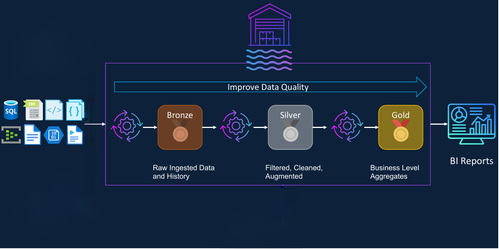
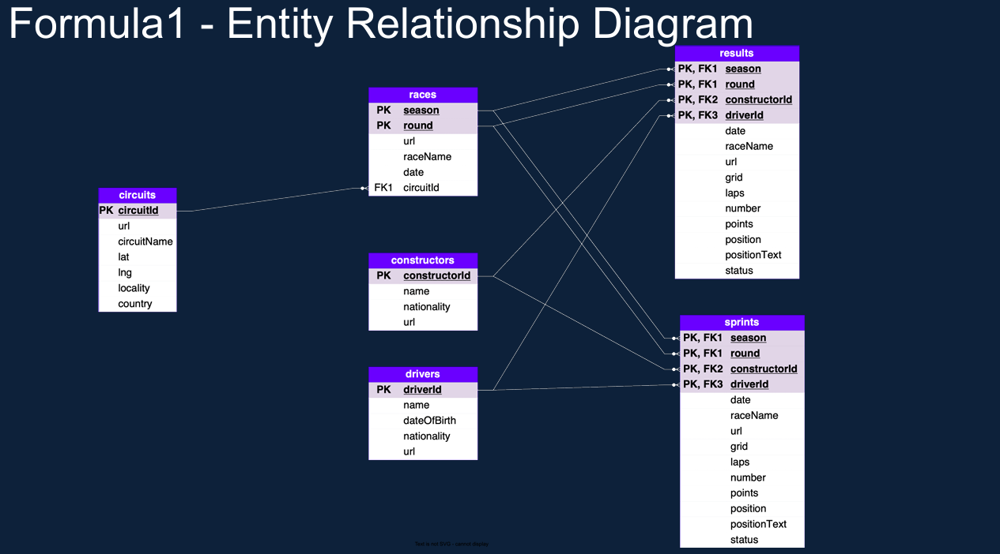

# F1 Car Race Data Engineering Project

## 📚 Table of Contents

- [🏎️ Project overview](#️-project-overview)
- [📂 Project structure](#-project-structure)
- [🏗️ Architecture and data flow](#️-architecture-and-data-flow)
- [🗂️ Entity relationship diagram](#️-entity-relationship-diagram)
- [🗃️ Data model and analytics focus](#️-data-model-and-analytics-focus)
- [▶️ Typical workflow to run the project](#️-typical-workflow-to-run-the-project)
- [📋 Prerequisites](#-prerequisites)
- [🔧 Key configuration values](#-key-configuration-values)
- [🔁 Example of the pipeline pattern](#-example-of-the-pipeline-pattern)

  ---
  
## 🏎️ Project overview

A Databricks-based end-to-end Formula 1 data engineering project that ingests raw race data, transforms it through bronze/silver/gold layers, creates curated analytical views, and supports dashboard-style reporting.

This repository is organized as a batch-style data pipeline for Formula 1 data using Delta Lake and Databricks notebooks. It follows a medallion architecture pattern:

- Bronze: raw ingested files
- Silver: cleaned and standardized data
- Gold: business-ready dimension/fact tables
- Analytics: curated views for reporting
- Dashboard: SQL-based KPI queries and dashboard assets

This project is designed to collect and process Formula 1 datasets such as:

- Circuits
- Races
- Constructors
- Drivers
- Results
- Sprint data

The repository uses:
- Databricks notebooks
- Delta tables
- Unity Catalog / catalog + schema structure
- Azure Data Lake Storage Gen2 (ADLS) external locations
- Batch orchestration patterns

---

## 📂 Project structure

```text
F1-Car-race-DB-project/
├── 00-common/
│   ├── 01.Environment-config.ipynb
│   ├── 02.bronze-helpers.ipynb
│   ├── 03.silver-helpers.ipynb
│   └── 04.gold-helpers.ipynb
├── 01-setup/
│   └── 01.Setup project environment.ipynb
├── 02-bronze/
│   ├── 01.Ingest circuits file.ipynb
│   ├── 02.Ingest races file.ipynb
│   ├── 03.Ingest constructors file.ipynb
│   ├── 04.Ingest drivers file.ipynb
│   ├── 05.Ingest results file.ipynb
│   └── 06.Ingest sprints file.ipynb
├── 03-silver/
│   ├── 01.Transform circuits data.ipynb
│   ├── 02.Transform races data.ipynb
│   ├── 03.Transform constructors data.ipynb
│   ├── 04.Transform drivers data.ipynb
│   ├── 05.Transform results data.ipynb
│   └── 06.Transform sprints data.ipynb
├── 04-gold/
│   ├── 01.Build races dimension.ipynb
│   ├── 02.Build constructors dimension.ipynb
│   ├── 03.Build drivers dimension.ipynb
│   ├── 04.Build results facts.ipynb
│   └── 91.Build Nationality Region Reference.ipynb
├── 05-analytics/
│   ├── 01.Build drivers standings view.ipynb
│   └── 02.Build constructor standings view.ipynb
├── 06-orchestration/
│   ├── 00.create control  tables.ipynb
│   ├── 01.Identify next batch.ipynb
│   ├── 02.Create new batch.ipynb
│   └── 03.Complete batch.ipynb
├── 07-dashboard/
│   ├── Constructor dnf analysis.sql
│   ├── Cumulative driver performance.sql
│   ├── Dominant constructor.sql
│   ├── Dominant drivers.sql
│   ├── Formula1 analytics dashboard.lvdash.json
│   └── Race retirement analysis.sql
├── 08-pipeline/
│   ├── formula1_lakehouse_incremental_refresh.yaml
│   └──job_formula1_incrmental_batch_orchestration.yaml
├── dataset/
│   └── formula1-incremental-load-landing/  # contain raw dataset
└── README.md
```

---

## 🏗️ Architecture and data flow

The project follows a layered architecture:



### 1. Common utilities
The `00-common` folder contains configuration and helper functions reused by every notebook.

- `01.Environment-config.ipynb`
  - Defines catalog and schema variables
  - Specifies the landing folder path
  - Typical values:
    - catalog_name = `formula1_incr`
    - bronze_schema = `bronze`
    - silver_schema = `silver`
    - gold_schema = `gold`
    - control_schema = `control`
    - landing folder = `/Volumes/formula1_incr/landing/files`

- `02.bronze-helpers.ipynb`
  - Adds ingestion metadata
  - Writes raw source data into Delta tables
  - Uses `batch_id` for partitioning and incremental tracking

These helper notebooks keep the pipeline consistent and reusable.

---

### 2. Setup
`01-setup/01.Setup project environment.ipynb`

This notebook is used to:
- create the external storage location
- create the catalog
- create schemas for landing, bronze, silver, gold
- create external volume for landing files
- validate the filesystem and catalog configuration

This is the foundation step before any data loads begin.

---

### 3. Bronze layer
`02-bronze/`

The bronze layer ingests raw CSV files from the landing storage into Delta tables.

Examples:
- circuits.csv -> `formula1_incr.bronze.circuits`
- races.csv -> `formula1_incr.bronze.races`
- constructors.csv -> `formula1_incr.bronze.constructors`
- drivers.csv -> `formula1_incr.bronze.drivers`
- results.csv -> `formula1_incr.bronze.results`
- sprints.csv -> `formula1_incr.bronze.sprints`

Each notebook:
- reads a raw CSV file
- defines a schema
- captures metadata (source file, ingestion timestamp)
- adds a `batch_id`
- writes it to a bronze Delta table using `overwrite` + `replaceWhere`

This ensures traceability of each dataset at ingestion time.

---

### 4. Silver layer
`03-silver/`

The silver layer cleans, standardizes, and enriches bronze data.

Typical transformations include:
- type casting
- null handling
- resolving column naming inconsistencies
- deduplicating records
- normalizing values
- shaping business-friendly data for downstream reporting

This layer is where raw operational data becomes usable analytical data.

---

### 5. Gold layer
`04-gold/`

This layer builds the curated business tables used by reporting and analytical queries.

Examples:
- dimension tables for races, constructors, drivers
- fact tables such as results
- reference data such as nationality-to-region

The project appears to build tables like:
- race dimension
- constructor dimension
- driver dimension
- fact_session_results
- nationality region reference

These gold tables support leaderboards, historical analysis, and dashboard summaries.

---

### 6. Analytics layer
`05-analytics/`

This folder contains business-level views for analysis.

Examples:
- `formula1.gold.v_driver_standing`
- `formula1.gold.v_constructor_standing`

The driver standing view calculates:
- season
- driver_id
- driver_name
- nationality
- race_starts
- total_points
- number_of_wins
- number_of_podiums
- rank within each season

This is a key analytics artifact used by downstream visualizations.

---

### 7. Orchestration
`06-orchestration/`

This folder manages pipeline orchestration and batch control.

Notebooks include:
- create control tables
- identify next batch
- create new batch
- complete batch

This suggests the project supports incremental loading and a mechanism for tracking pipeline batch state.

The control table likely stores:
- batch_id
- status
- created_timestamp
- updated_timestamp

This is a crucial operational component for reproducible batch processing.

---

### 8. Dashboard
`07-dashboard/`

This folder includes SQL queries and a dashboard definition file.

Files include:
- `Dominant drivers.sql`
- `Dominant constructor.sql`
- `Race retirement analysis.sql`
- `Constructor dnf analysis.sql`
- `Cumulative driver performance.sql`
- `Formula1 analytics dashboard.lvdash.json`

These queries likely summarize:
- championship impact
- podium performance
- retirement and DNF analysis
- cumulative driver performance
- constructor dominance

This layer is intended to turn the gold/analytics data into operational and executive-facing insights.

---

### 9. Pipelines 

This repo includes Databricks job definitions to run the pipeline end-to-end in an automated fashion. The pipeline artifacts live in the `08-pipeline/` folder:

- `08-pipeline/formula1_lakehouse_incremental_refresh.yaml` — job definition that runs the incremental refresh job named `formula1_lakehouse incremental_refresh`. This job runs the ingestion -> silver transforms -> gold builds for each dataset. It accepts the pipeline parameter `p_batch_id` and contains tasks that run notebooks in the correct dependency order.
- `08-pipeline/job_formula1_incremental_batch_orchestration.yaml` — orchestration job definition named `job_formula1_incremental_batch_orchestration`. This job controls the batch lifecycle:
  - `01_identify_next_batches` — identifies the next batch to process.
  - conditional step `is_there_a_batch_to_process` — proceeds only if a batch exists.
  - `02_create_new_batch` — creates a new batch control record (propagates `p_batch_id`).
  - `run_job_formula1_lakehouse_incremental_refresh` — triggers the refresh job (the incremental refresh job id is set inside this orchestration job).
  - `03_complete_batch` — marks the batch complete.

---

## 🗂️ Entity relationship diagram 



--- 

## 🗃️ Data model and analytics focus

The repo is clearly centered on Formula 1 racing metrics. The likely analytical dimensions/facts include:

- Driver metrics:
  - wins
  - podiums
  - championships
  - race starts
  - total points

- Constructor metrics:
  - team wins
  - podiums
  - season performance
  - DNF/retirement patterns

- Race metrics:
  - season
  - round
  - date
  - circuit info
  - winner and participant data

- Session results:
  - points
  - position
  - qualification performance
  - race outcome

---

## ▶️ Typical workflow to run the project 

1. **Import notebooks into Databricks**

   Download the project notebooks from this GitHub repository and import the .ipynb files into your Databricks workspace, preserving the folder structure.

2. **Update configuration**

   Edit `00-common/01.Environment-config.ipynb` with your catalog, schemas, and landing path.

3. **Import Jobs**

   Import the YAML files from `08-pipeline/` into the Databricks Jobs UI:
   - `formula1_lakehouse_incremental_refresh`
   - `job_formula1_incremental_batch_orchestration`

   Verify notebook paths and job IDs.

4. **Run the pipeline**

   Run the orchestration job `job_formula1_incremental_batch_orchestration` from the Databricks Jobs UI. It automatically identifies the next batch, runs the refresh job, and completes the batch.

   Optional CLI:

   ```bash
   databricks jobs run-now --job-id <ORCHESTRATION_JOB_ID>
   ```

5. **Verify the results**

   Check job logs and confirm that Delta tables are updated under `formula1_incr`:
   - `bronze`
   - `silver`
   - `gold`

**Note:** Ensure that `p_batch_id` is passed through and propagated correctly by the orchestration job.

---

## 📋 Prerequisites

To run this project successfully, you will need:

- Databricks workspace
- Unity Catalog enabled
- Azure Data Lake Storage Gen2 container / filesystem
- External location and credentials configured
- Catalog named `formula1_incr`
- Supported Spark / PySpark environment
- Notebook execution permissions

This repo assumes that the storage and identity layer already exists and is configured as the pipeline backend.

---

## 🔧 Key configuration values

The project uses configuration values similar to the following:

```python
catalog_name = 'formula1_incr'
bronze_schema = 'bronze'
silver_schema = 'silver'
gold_schema = 'gold'
control_schema = 'control'
landing_folder_path = '/Volumes/formula1_incr/landing/files'
```

And external storage is referenced using Azure Data Lake paths similar to:

```sql
abfss://formula1-incr@databrickscourseexterdl1.dfs.core.windows.net/
```

These values are important because the pipeline depends on the storage location and catalog structure being exactly aligned.

---

## 🔁 Example of the pipeline pattern

Each ingestion notebook follows a similar template:

1. Get batch parameter (`p_batch_id`)
2. Load shared config
3. Load helper functions
4. Set source file and target table variables
5. Read CSV with a strict schema
6. Add metadata columns
7. Validate result
8. Write to bronze Delta table with batch partitioning

This consistent pattern reduces complexity and makes the pipeline easy to extend.

---
